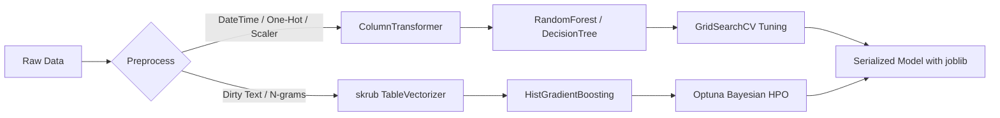
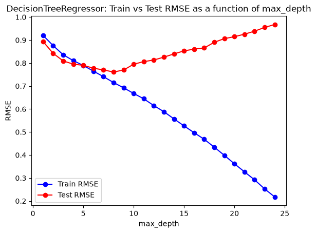
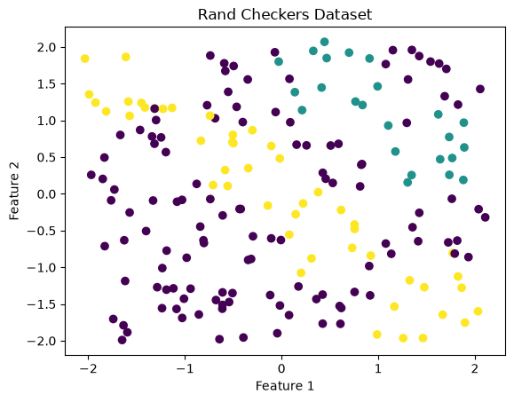
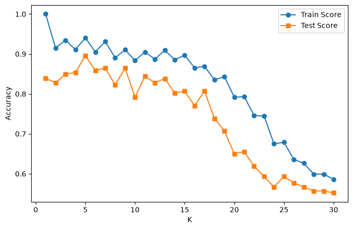

# End-to-End Supervised ML, Bayesian Optimization & Fuzzy Entity Resolution

[](https://www.python.org/)
[](https://scikit-learn.org/)
[](https://optuna.org/)
[](https://skrub-data.org/)
[](https://www.polytechnique.edu/)
[](https://www.hec.edu/)

> **Comprehensive Applied Machine Learning Lab** developed as part of the *Python for Data Science* curriculum in the **MSc Data Science & AI for Business** (École Polytechnique / HEC Paris), taught by Mathurin Massias (Inria / ENS).

---

## 📌 Executive Summary

This repository presents an end-to-end applied machine learning system addressing four core challenges in modern data science:
1. **Production-Ready ML Pipelines:** Multi-modal feature engineering, tree-depth tuning, hyperparameter search via `GridSearchCV`, and model serialization with `joblib`.
2. **Algorithmic Implementation from Scratch:** Building a custom `KNearestNeighbor` classifier inheriting from Scikit-Learn's `BaseEstimator` and `ClassifierMixin`, with full 10-fold cross-validation and bias-variance analysis.
3. **Bayesian Hyperparameter Optimization:** Tuning Gradient Boosted Trees (`HistGradientBoostingClassifier`) on the Adult Census dataset using **Optuna** across 5-fold cross-validation, comparing One-Hot vs. Ordinal encodings.
4. **Fuzzy Entity Resolution & Automated Preprocessing with `skrub`:** Solving high-cardinality and dirty string modalities in salary prediction using `GapEncoder` (subword character n-grams) and automated end-to-end tabular pipelines with `TableVectorizer`.

---

## 🏗️ Architecture & Key Components



---

## 🚀 Part 1: Flight Passenger Regression & Scikit-Learn Pipelines

* **Goal:** Predict airline passenger volume (`log_PAX`) from temporal and airport routing features.
* **Feature Engineering:** Extracted cyclical calendar features (day of week, month, year, weekend indicators) and US Federal Holidays calendar via `pandas.tseries.holiday`.
* **StandardScaler Invariance:** Mathematically verified and empirically demonstrated that decision tree splits and unregularized OLS linear regression are strictly invariant to affine feature scaling.
* **Depth Optimization:** Iterative evaluation of `DecisionTreeRegressor` across depths $d \in [1, 24]$, highlighting overfitting beyond $d=8$.

<p align="center">
  
  <br><em>Train vs. Test RMSE as a function of tree max_depth. Optimal generalization occurs at depth 8.</em>
</p>

* **Production Pipeline:**
  ```python
  preprocessor = ColumnTransformer(transformers=[
      ('num', StandardScaler(), num_cols),
      ('cat', OneHotEncoder(handle_unknown='ignore'), cat_cols)
  ])

  rf_pipe = Pipeline([
      ('preprocessor', preprocessor),
      ('rf', RandomForestRegressor(random_state=42))
  ])
  ```
* **Hyperparameter Tuning:** 3-fold `GridSearchCV` over `n_estimators` $\in [50, 100]$ and `max_depth` $\in [10, 20, \text{None}]$, achieving test **RMSE of 0.4701**.
* **Model Persistence:** Exported and reloaded the complete pipeline and individual estimators via `joblib.dump()` / `joblib.load()` with bit-exact prediction verification.

---

## 🔬 Part 2: Custom KNN Classifier from Scratch

Implemented a native Scikit-Learn compatible `KNearestNeighbor` classifier from first principles.

### Complexity Analysis
* **Fitting Cost:** $\mathcal{O}(1)$ time complexity (lazy learner storing matrices in memory), $\mathcal{O}(n \cdot d)$ spatial footprint.
* **Prediction Cost:** $\mathcal{O}(n \cdot d)$ operations per test query to compute pairwise Euclidean distances against all $n$ training instances across $d$ dimensions.

### Empirical Evaluation on `rand_checkers`
Evaluated 10-fold cross-validation on non-linear alternating checkerboard clusters ($n=192$, 3 classes):

<p align="center">
  
  
  <br><em>Left: Non-linear synthetic 3-class distribution. Right: 10-fold CV Train vs Test accuracy curve for K ∈ [1, 30].</em>
</p>

* **$k=1$ (Overfitting):** 100% training accuracy because every point is its own nearest neighbor, but test accuracy degrades due to local noise sensitivity.
* **$k=5$ (Optimal Trade-off):** Maximizes test accuracy (~90%), smoothing noise while respecting class boundaries.
* **$k > 15$ (Underfitting):** The neighborhood radius exceeds individual checkerboard squares, mixing distinct classes.

---

## ⚡ Part 3: Adult Census Classification & Optuna Bayesian HPO

Benchmarked three classifiers across two encoding strategies on the Adult Census dataset (~49,000 rows):

| Model | Encoding | Validation / Test Accuracy | Training Efficiency |
| :--- | :--- | :---: | :---: |
| **Logistic Regression** | One-Hot | **85.70%** | Baseline |
| **Logistic Regression** | Ordinal | 82.71% | Severe drop (linear assumption violated) |
| **Random Forest** | One-Hot | 86.51% | High memory (~100 sparse columns) |
| **Random Forest** | Ordinal | **86.48%** | Fast & compact |
| **HistGradientBoosting (Default)** | Ordinal | 87.86% | Very fast |
| **HistGradientBoosting + Optuna** | **Ordinal** | **87.40%** | **Optimal (~0.054 learning rate)** |
| **HistGradientBoosting + Optuna** | **One-Hot** | **87.39%** | Identical ceiling to Ordinal |

### Bayesian Optimization with Optuna
Configured a 60-trial Bayesian search (30 trials for Ordinal, 30 for One-Hot) across 5-fold cross-validation:
```python
def objective(trial):
    lr = trial.suggest_float('learning_rate', 1e-3, 1.0, log=True)
    pipe = Pipeline([
        ('prep', preprocessor_ord),
        ('model', HistGradientBoostingClassifier(learning_rate=lr, random_state=42))
    ])
    return np.mean(cross_val_score(pipe, X, y, cv=5, scoring="accuracy"))
```
* **Key Finding:** Tree-based gradient boosting achieves identical performance on Ordinal and One-Hot encodings. Using Ordinal encoding preserves feature dimensionality (14 columns instead of 100+), drastically speeding up computation.

---

## 🧩 Part 4: Fuzzy Categorical Data & `skrub`

Real-world datasets contain unstructured, high-cardinality text columns prone to typos and morphological variants.

### The Problem
In the Montgomery County public employee dataset:
* `employee_position_title` contains hundreds of rare or distinct modalities (e.g., *"Police Officer I"*, *"Police Officer II"*, *"Library Assistant"*).
* Standard `OneHotEncoder` creates thousands of sparse, uninformative columns and completely fails on unseen categories or minor typos at inference time.

### Gamma-Poisson Factorization (`GapEncoder`)
Using `skrub.GapEncoder(n_components=2)`, modalities are decomposed across latent topics using character subword $n$-grams:

```python
clean = enc.transform(pd.DataFrame([["physics"]]))
dirty = enc.transform(pd.DataFrame([["physcis"]])) # deliberate typo
```
* **Result:** Both `"physics"` and the misspelled `"physcis"` activate the physics latent topic with nearly identical representations, providing robust zero-shot resilience against typographical errors.

### End-to-End Automated Pipeline
Built an automated regression pipeline using `skrub.TableVectorizer`:
```python
final_pipeline = Pipeline([
    ('prep', TableVectorizer()),
    ('hgbr', HistGradientBoostingRegressor(random_state=42))
])
final_pipeline.fit(salary_X, salary_y)
```
* **Outcome:** `TableVectorizer` automatically identifies data types, routing continuous features to `PassThrough`, dates to `DatetimeEncoder`, low-cardinality categories to `OneHotEncoder`, and high-cardinality text to `StringEncoder`.
* **Performance:** Achieved an $R^2$ of **0.907** and an RMSE of **\$8,950** on annual salary prediction.

---

## 📁 Repository Structure

```text
├── ml_pipelines_optuna_skrub.ipynb   # Complete annotated Jupyter notebook
├── report.html                       # Standalone compiled HTML interactive report
├── utils.py                          # Synthetic data generation utilities
├── train.csv.bz2                     # Flight dataset
├── skrub_data_lab3/                  # Montgomery County salaries dataset
│   ├── salary_X.csv
│   └── salary_y.csv
├── img/                              # High-resolution benchmark figures
│   ├── decision_tree_depth.png
│   ├── rand_checkers.png
│   └── knn_cv_curve.png
└── README.md
```

---

## 🛠️ Installation & Reproduction

```bash
# Clone the repository
git clone https://github.com/victorpiana/ml-pipelines-optuna-skrub.git
cd ml-pipelines-optuna-skrub

# Create a virtual environment
python -m venv venv
source venv/bin/activate

# Install required packages
pip install numpy pandas scikit-learn optuna skrub matplotlib scipy
```

Open the notebook in Jupyter:
```bash
jupyter lab ml_pipelines_optuna_skrub.ipynb
```
Or view the full interactive report directly in your browser by opening `report.html`.

---

## 👨‍💻 Author

**Victor Piana**
* Master of Science in Data Science & AI for Business — **École Polytechnique & HEC Paris**
* LinkedIn: [linkedin.com/in/victor-piana-107230238](https://www.linkedin.com/in/victor-piana-107230238/)
* GitHub: [@victorpiana](https://github.com/victorpiana)
